<div id="-início" align="center">

<picture>
  <source media="(prefers-color-scheme: dark)" srcset="./assets/header-dark.svg">
  <source media="(prefers-color-scheme: light)" srcset="./assets/header-light.svg">
  
</picture>

<br>

<picture>
  <source media="(prefers-color-scheme: dark)" srcset="./assets/typing-dark.svg">
  <source media="(prefers-color-scheme: light)" srcset="./assets/typing-light.svg">
  
</picture>

<br><br>

<!-- Badges de Contato e Acesso Rápido -->
<p align="center">
  <a href="https://www.linkedin.com/in/jo%C3%A3omarcelos/" title="Conectar no LinkedIn">
    
  </a>
  &nbsp;
  <a href="https://portfolio-eight-azure-m62na8bqo9.vercel.app/" title="Ver Portfólio Online">
    
  </a>
  &nbsp;
  <a href="mailto:joaogarces.dev@gmail.com" title="Enviar e-mail para João Marcelo">
    
  </a>
  &nbsp;
  <a href="https://github.com/snoopyjmX?tab=repositories" title="Ver repositórios de João Marcelo">
    
  </a>
</p>

<!-- Navegação Visual Cyberpunk -->
<picture>
  <source media="(prefers-color-scheme: dark)" srcset="./assets/nav-dark.svg">
  <source media="(prefers-color-scheme: light)" srcset="./assets/nav-light.svg">
  
</picture>

<p align="center">
  <a href="#01--sobre" title="Ir para seção Sobre"><code>01. sobre</code></a>
  &nbsp;·&nbsp;
  <a href="#02--projetos" title="Ir para seção Projetos"><code>02. projetos</code></a>
  &nbsp;·&nbsp;
  <a href="#03--stack" title="Ir para seção Stack"><code>03. stack</code></a>
  &nbsp;·&nbsp;
  <a href="#04--atividade" title="Ir para seção Atividade"><code>04. atividade</code></a>
  &nbsp;·&nbsp;
  <a href="#05--contato" title="Ir para seção Contato"><code>05. contato</code></a>
</p>

</div>

<br>

<picture>
  <source media="(prefers-color-scheme: dark)" srcset="./assets/divider-dark.svg">
  <source media="(prefers-color-scheme: light)" srcset="./assets/divider-light.svg">
  
</picture>

<br>

<!-- SEÇÃO 01: SOBRE -->
<div id="01--sobre">

<picture>
  <source media="(prefers-color-scheme: dark)" srcset="./assets/section-sobre-dark.svg">
  <source media="(prefers-color-scheme: light)" srcset="./assets/section-sobre-light.svg">
  
</picture>

</div>

```typescript
interface Developer {
  nome: string;
  localizacao: string;
  formacao: string;
  ocupacao: string;
  focoEstudo: {
    frontend: string;
    backend: string;
    devops: string;
  };
  interesses: string[];
  idiomas: Record<string, string>;
}

const joao: Developer = {
  nome: "João Marcelo Garcês",
  localizacao: "Goiânia, GO — Brasil",
  formacao: "Engenharia de Software (UniGOiás)",
  ocupacao: "Estagiário de TI & Desenvolvedor Full-Stack",
  focoEstudo: {
    frontend: "50% (React, TypeScript, Vite, Tailwind, React Native, PWA)",
    backend: "30% (Node.js, Express, PostgreSQL, Prisma, Supabase)",
    devops: "20% (Docker, GitHub Actions, CI/CD, Playwright, pgTAP)"
  },
  interesses: [
    "Aplicações web modernas com foco em performance e DX",
    "Inteligência Artificial aplicada e engenharia de prompt",
    "Arquitetura resiliente e suítes completas de testes automatizados",
    "Design systems consistentes e acessibilidade real (WCAG)",
    "Pipelines de integração contínua e automação de deploy"
  ],
  idiomas: {
    portugues: "nativo",
    ingles: "intermediário",
    espanhol: "intermediário"
  }
};
```

Construo software com foco em usabilidade, estabilidade e arquitetura sustentável. Acredito que qualidade técnica se demonstra no código em produção e em suítes de testes confiáveis, não em templates vazios. Meu aprendizado é direcionado à prática e à resolução de problemas reais em equipe.

<p align="right"><a href="#-início" title="Voltar ao início"><code>[↑ voltar ao topo]</code></a></p>

<picture>
  <source media="(prefers-color-scheme: dark)" srcset="./assets/divider-dark.svg">
  <source media="(prefers-color-scheme: light)" srcset="./assets/divider-light.svg">
  
</picture>

<br>

<!-- SEÇÃO 02: PROJETOS -->
<div id="02--projetos">

<picture>
  <source media="(prefers-color-scheme: dark)" srcset="./assets/section-projetos-dark.svg">
  <source media="(prefers-color-scheme: light)" srcset="./assets/section-projetos-light.svg">
  
</picture>

</div>

<table width="100%" align="center" border="0" cellpadding="0" cellspacing="8">
  <tr>
    <td width="33.3%" align="center" valign="top">
      <!-- Sillage: em produção na Vercel (repositório privado em refinamento) -->
      <a href="https://sillage-jm-x.vercel.app/" title="Acessar Sillage (PWA em Produção)">
        <picture>
          <source media="(prefers-color-scheme: dark)" srcset="./assets/card-sillage-dark.svg">
          <source media="(prefers-color-scheme: light)" srcset="./assets/card-sillage-light.svg">
          
        </picture>
      </a>
    </td>
    <td width="33.3%" align="center" valign="top">
      <!-- NÓS: em produção na Vercel -->
      <a href="https://nos-app-v1.vercel.app/welcome" title="Acessar NÓS (PWA em Produção)">
        <picture>
          <source media="(prefers-color-scheme: dark)" srcset="./assets/card-nos-dark.svg">
          <source media="(prefers-color-scheme: light)" srcset="./assets/card-nos-light.svg">
          
        </picture>
      </a>
    </td>
    <td width="33.3%" align="center" valign="top">
      <!-- Paggo.AI: TCC em equipe -->
      <a href="https://github.com/renanrodriguescodes/Paggo" title="Ver repositório do Paggo.AI">
        <picture>
          <source media="(prefers-color-scheme: dark)" srcset="./assets/card-paggo-dark.svg">
          <source media="(prefers-color-scheme: light)" srcset="./assets/card-paggo-light.svg">
          
        </picture>
      </a>
    </td>
  </tr>
</table>

<details>
  <summary><b>01. Sillage — PWA de Perfumaria de Nicho</b> <i>(clique para expandir detalhes técnicos)</i></summary>
  <br>
  <p><b>O que é:</b> PWA para catálogo, exploração olfativa e gestão de coleções pessoais de perfumaria de nicho (estilo enciclopédia interativa + acervo pessoal).</p>
  <p><b>Stack:</b> React 19, Vite, TypeScript, Tailwind CSS, TanStack Query, Zod, Supabase (PostgreSQL).</p>
  <p><b>Decisões Técnicas:</b> Estruturação de dados com validação rigorosa de schemas via Zod, cache assíncrono otimizado com TanStack Query, e arquitetura de banco com Row Level Security (RLS) no Supabase.</p>
  
| Camada de Qualidade | Ferramenta / Validador | Cobertura / Volume |
| :--- | :--- | :--- |
| **Testes End-to-End** | Playwright (desktop + mobile) | 49 testes automatizados |
| **Testes de Banco** | pgTAP | 220 asserções de integridade e RLS |
| **Testes Unitários** | Vitest | 123 testes |
| **Acessibilidade** | axe-core | Conformidade WCAG AA |
| **Integração Contínua** | GitHub Actions | Pipeline em cada PR |

  <p><b>Deploy em produção:</b> <a href="https://sillage-jm-x.vercel.app/"><code>https://sillage-jm-x.vercel.app/</code></a></p>
  <p><b>Status atual:</b> Fases 1 a 4 de 12 concluídas. Próxima etapa: preview por PR via Vercel e fluxo de autenticação.</p>
  <p><i>Nota: Repositório de código privado em fase de refinamento arquitetural.</i></p>
  <!--  -->
</details>

<br>

<details>
  <summary><b>02. NÓS — Aplicação Privada para Casais</b> <i>(clique para expandir)</i></summary>
  <br>
  <p><b>O que é:</b> Aplicativo privado voltado para comunicação exclusiva de casal, centralizando mensagens, linha do tempo de memórias e contagem de datas comemorativas.</p>
  <p><b>Stack:</b> React Native, Expo Router, TypeScript, React Native Reanimated, Supabase (Auth, Realtime, Storage, RLS).</p>
  <p><b>Destaques de Engenharia:</b></p>
  <ul>
    <li>Políticas de Row Level Security (RLS) estritas e versionadas, assegurando isolamento total de dados entre pares.</li>
    <li>Mecanismo de convites por código criptográfico para pareamento seguro.</li>
    <li>Cabeçalhos de segurança HTTP e CSP configurados no build de produção.</li>
    <li>Auditoria contínua de dependências contra vulnerabilidades conhecidas.</li>
    <li>Redesign completo com sistema de design proprietário e micro-interações fluidas via Reanimated.</li>
  </ul>
  <p><b>Deploy:</b> Em produção como PWA na Vercel: <a href="https://nos-app-v1.vercel.app/welcome"><code>https://nos-app-v1.vercel.app/welcome</code></a></p>
  <p><b>Repositório:</b> <a href="https://github.com/snoopyjmX/nos-app"><code>github.com/snoopyjmX/nos-app</code></a></p>
  <!--  -->
</details>

<br>

<details>
  <summary><b>03. Paggo.AI — Controle Financeiro Pessoal (TCC)</b> <i>(clique para expandir)</i></summary>
  <br>
  <p><b>O que é:</b> Plataforma de inteligência financeira pessoal unificada em ambiente web e mobile, desenvolvida como Trabalho de Conclusão de Curso em equipe de 3 engenheiros.</p>
  <p><b>Stack:</b> React, React Router, Recharts, Node.js, Express, Prisma ORM, PostgreSQL, Expo, Open Finance API.</p>
  <p><b>Meu Papel no Projeto:</b></p>
  <ul>
    <li>Desenvolvimento do front-end web: fluxos de cadastro de usuários, conexão de contas bancárias e gestão de carteiras de investimentos.</li>
    <li>Implementação e liderança de QA (garantia de qualidade de interface e testes de integração com APIs).</li>
    <li>Renderização de relatórios analíticos dinâmicos e dashboards preditivos com Recharts.</li>
  </ul>
  <p><b>Repositório:</b> <a href="https://github.com/renanrodriguescodes/Paggo"><code>github.com/renanrodriguescodes/Paggo</code></a></p>
  <!--  -->
</details>

<p align="right"><a href="#-início" title="Voltar ao início"><code>[↑ voltar ao topo]</code></a></p>

<picture>
  <source media="(prefers-color-scheme: dark)" srcset="./assets/divider-dark.svg">
  <source media="(prefers-color-scheme: light)" srcset="./assets/divider-light.svg">
  
</picture>

<br>

<!-- SEÇÃO 03: STACK -->
<div id="03--stack">

<picture>
  <source media="(prefers-color-scheme: dark)" srcset="./assets/section-stack-dark.svg">
  <source media="(prefers-color-scheme: light)" srcset="./assets/section-stack-light.svg">
  
</picture>

</div>

<p>Ecossistema tecnológico organizado pela minha trilha de foco de estudos (50% front-end · 30% back-end · 20% ops e qualidade):</p>

<table width="100%" align="center" border="0" cellpadding="0" cellspacing="8">
  <tr>
    <td width="33.3%" align="center" valign="top">
      <picture>
        <source media="(prefers-color-scheme: dark)" srcset="./assets/stack-frontend-dark.svg">
        <source media="(prefers-color-scheme: light)" srcset="./assets/stack-frontend-light.svg">
        
      </picture>
    </td>
    <td width="33.3%" align="center" valign="top">
      <picture>
        <source media="(prefers-color-scheme: dark)" srcset="./assets/stack-backend-dark.svg">
        <source media="(prefers-color-scheme: light)" srcset="./assets/stack-backend-light.svg">
        
      </picture>
    </td>
    <td width="33.3%" align="center" valign="top">
      <picture>
        <source media="(prefers-color-scheme: dark)" srcset="./assets/stack-ops-dark.svg">
        <source media="(prefers-color-scheme: light)" srcset="./assets/stack-ops-light.svg">
        
      </picture>
    </td>
  </tr>
</table>

<p align="right"><a href="#-início" title="Voltar ao início"><code>[↑ voltar ao topo]</code></a></p>

<picture>
  <source media="(prefers-color-scheme: dark)" srcset="./assets/divider-dark.svg">
  <source media="(prefers-color-scheme: light)" srcset="./assets/divider-light.svg">
  
</picture>

<br>

<!-- SEÇÃO 04: ATIVIDADE -->
<div id="04--atividade">

<picture>
  <source media="(prefers-color-scheme: dark)" srcset="./assets/section-atividade-dark.svg">
  <source media="(prefers-color-scheme: light)" srcset="./assets/section-atividade-light.svg">
  
</picture>

</div>

<table width="100%" align="center" border="0" cellpadding="0" cellspacing="8">
  <tr>
    <td width="50%" align="center" valign="top">
      <picture>
        <source media="(prefers-color-scheme: dark)" srcset="./assets/generated/stats-dark.svg">
        <source media="(prefers-color-scheme: light)" srcset="./assets/generated/stats-light.svg">
        
      </picture>
    </td>
    <td width="50%" align="center" valign="top">
      <picture>
        <source media="(prefers-color-scheme: dark)" srcset="./assets/generated/streak-dark.svg">
        <source media="(prefers-color-scheme: light)" srcset="./assets/generated/streak-light.svg">
        
      </picture>
    </td>
  </tr>
</table>

<br>

<picture>
  <source media="(prefers-color-scheme: dark)" srcset="./assets/generated/languages-dark.svg">
  <source media="(prefers-color-scheme: light)" srcset="./assets/generated/languages-light.svg">
  
</picture>

<br><br>

<picture>
  <source media="(prefers-color-scheme: dark)" srcset="./assets/generated/heatmap-dark.svg">
  <source media="(prefers-color-scheme: light)" srcset="./assets/generated/heatmap-light.svg">
  
</picture>

<br><br>

<picture>
  <source media="(prefers-color-scheme: dark)" srcset="./assets/generated/hours-dark.svg">
  <source media="(prefers-color-scheme: light)" srcset="./assets/generated/hours-light.svg">
  
</picture>

<br>

### Atividade Recente

<!-- ACTIVITY:START -->
- [`snoopyjmX/sillage`](https://github.com/snoopyjmX/sillage) — **push de commits** <kbd>há 14 dias</kbd>
- [`snoopyjmX/sillage`](https://github.com/snoopyjmX/sillage) — **atividade de desenvolvimento** <kbd>há 25 dias</kbd>
- [`snoopyjmX/snoopyjmX`](https://github.com/snoopyjmX/snoopyjmX) — **criou branch em snoopyjmX/snoopyjmX** <kbd>há 15 dias</kbd>
- [`snoopyjmX/snoopyjmX`](https://github.com/snoopyjmX/snoopyjmX) — **push de commits** <kbd>há 15 dias</kbd>
- [`snoopyjmX/snoopyjmX`](https://github.com/snoopyjmX/snoopyjmX) — **criou branch em snoopyjmX/snoopyjmX** <kbd>há 15 dias</kbd>
- [`snoopyjmX/nexus-it`](https://github.com/snoopyjmX/nexus-it) — **atividade de desenvolvimento** <kbd>há 16 dias</kbd>
<!-- ACTIVITY:END -->

<br>

### Contribuições em Movimento (Snake)

<div align="center">
  <picture>
    <source media="(prefers-color-scheme: dark)" srcset="https://raw.githubusercontent.com/snoopyjmX/snoopyjmX/output/github-snake-dark.svg">
    <source media="(prefers-color-scheme: light)" srcset="https://raw.githubusercontent.com/snoopyjmX/snoopyjmX/output/github-snake.svg">
    
  </picture>
</div>

<br>

<details>
  <summary><b>Como esses dados são gerados</b> <i>(arquitetura autônoma sem serviços externos)</i></summary>
  <br>
  <p>Os gráficos de atividade e métricas são gerados por um script proprietário em Node.js (<code>scripts/fetch-stats.mjs</code>) que consome diretamente a API GraphQL do GitHub através de token autenticado. A automação é orquestrada diariamente pelo GitHub Actions, eliminando qualquer dependência de serviços externos que sofrem instabilidade, rate limits ou quebras visuais.</p>
</details>

<p align="right"><a href="#-início" title="Voltar ao início"><code>[↑ voltar ao topo]</code></a></p>

<picture>
  <source media="(prefers-color-scheme: dark)" srcset="./assets/divider-dark.svg">
  <source media="(prefers-color-scheme: light)" srcset="./assets/divider-light.svg">
  
</picture>

<br>

<!-- SEÇÃO 05: CONTATO -->
<div id="05--contato">

<picture>
  <source media="(prefers-color-scheme: dark)" srcset="./assets/section-contato-dark.svg">
  <source media="(prefers-color-scheme: light)" srcset="./assets/section-contato-light.svg">
  
</picture>

</div>

Se você tem interesse em colaborar em projetos de código aberto, discutir arquitetura de aplicações, inteligência artificial ou trocar experiências sobre desenvolvimento full-stack e engenharia de software, entre em contato:

- **LinkedIn:** [linkedin.com/in/joãomarcelos](https://www.linkedin.com/in/jo%C3%A3omarcelos/)
- **Portfólio:** [portfolio-eight-azure-m62na8bqo9.vercel.app](https://portfolio-eight-azure-m62na8bqo9.vercel.app/)
- **E-mail:** [joaogarces.dev@gmail.com](mailto:joaogarces.dev@gmail.com)
- **GitHub:** [github.com/snoopyjmX](https://github.com/snoopyjmX)
- **Localização:** Goiânia, Goiás — Brasil

<p align="right"><a href="#-início" title="Voltar ao início"><code>[↑ voltar ao topo]</code></a></p>

<br>

<!-- RODAPÉ TERMINAL -->
<picture>
  <source media="(prefers-color-scheme: dark)" srcset="./assets/footer-dark.svg">
  <source media="(prefers-color-scheme: light)" srcset="./assets/footer-light.svg">
  
</picture>
